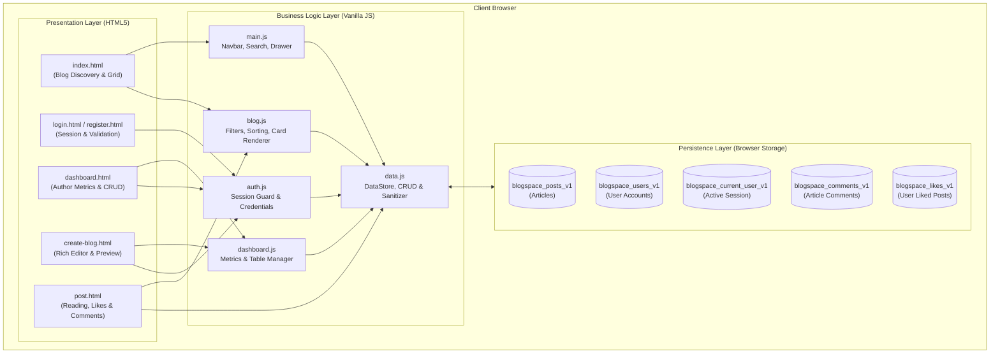

# 📰 BlogSpace — Modern Responsive Blog Application

> **Codomax Internship — Task 1: Complete Frontend Blog Application**  
> Built from the ground up with pure semantic **HTML5**, modern **CSS3**, and modular **Vanilla JavaScript**. Designed with clean architecture, client-side data persistence (`localStorage`), rich-text authoring, dynamic filtering, and a responsive mobile-first UI.

---

<div align="center">

[](https://developer.mozilla.org/en-US/docs/Web/HTML)
[](https://developer.mozilla.org/en-US/docs/Web/CSS)
[](https://developer.mozilla.org/en-US/docs/Web/JavaScript)
[](#-responsive-design--css-system)
[](#-technical-highlights--engineering-practices)
[](#-localstorage-data-schema)

[Quick Start](#-quick-start--local-setup) • [Demo Credentials](#-demo-credentials) • [Features](#-core-features-walkthrough) • [Architecture](#-application-architecture) • [Project Structure](#-project-directory-structure) • [Data Schema](#-localstorage-data-schema) • [Checklist](#-verification-checklist)

</div>

---

## 📑 Table of Contents

- [Automated Code Review](#automated-code-review)
- [📌 Project Overview](#-project-overview)
- [🚀 Quick Start & Local Setup](#-quick-start--local-setup)
- [🔑 Demo Credentials](#-demo-credentials)
- [🏗️ Application Architecture](#-application-architecture)
- [✨ Core Features Walkthrough](#-core-features-walkthrough)
  - [1. Homepage & Discovery (`index.html`)](#1-homepage--discovery-indexhtml)
  - [2. Authentication & Session Flow (`login.html` & `register.html`)](#2-authentication--session-flow-loginhtml--registerhtml)
  - [3. Author Dashboard & Metrics (`dashboard.html`)](#3-author-dashboard--metrics-dashboardhtml)
  - [4. Rich Blog Editor & Studio (`create-blog.html`)](#4-rich-blog-editor--studio-create-bloghtml)
  - [5. Article Reading Experience (`post.html`)](#5-article-reading-experience-posthtml)
- [📁 Project Directory Structure](#-project-directory-structure)
- [⚙️ Technical Highlights & Engineering Practices](#️-technical-highlights--engineering-practices)
  - [Responsive Design & CSS System](#-responsive-design--css-system)
  - [Modular Vanilla JavaScript Architecture](#-modular-vanilla-javascript-architecture)
  - [Security & XSS Mitigation](#-security--xss-mitigation)
- [💾 LocalStorage Data Schema](#-localstorage-data-schema)
- [📋 Verification Checklist](#-verification-checklist)
- [🛡️ Client-Side vs. Production Architecture](#️-client-side-vs-production-architecture)
- [👨‍💻 Submission & Internship Context](#-submission--internship-context-)

---
## Automated Code Review

This project uses CodeRabbit to review pull requests.
## 📌 Project Overview

**BlogSpace** is an editorial, full-featured web publishing application developed for **Codomax Internship Task 1**.

The goal of this project is to build an interactive, production-grade frontend application without relying on heavy frontend frameworks (like React, Vue, or Angular) or backend runtimes (Node.js/Django). It leverages standard browser APIs, modern CSS design tokens, and clean modular JavaScript to deliver a fast, responsive, and intuitive blogging experience.

### Key Highlights
- **100% Vanilla Tech Stack**: No external JS frameworks, no bundlers, and zero build steps required.
- **Persistent Data Layer**: Full CRUD capabilities (Create, Read, Update, Delete) utilizing browser `localStorage`.
- **Dynamic Content Discovery**: Instant search, multi-category filtering, and multi-criteria sorting.
- **Rich-Text Editor**: Live visual toolbar formatting, preset stock photography integration, chip tag input, and real-time preview toggle.
- **Reader Engagement**: Scrolling progress indicator, persistent like counter, interactive reader comments, and social sharing links.
- **Mobile-First Responsive Layout**: Fluid adaptation from mobile screens (375px) up to ultra-wide displays (1440px+).

---

## 🚀 Quick Start & Local Setup

Since BlogSpace is built purely with client-side HTML, CSS, and Vanilla JavaScript, there are **no package managers (`npm`/`yarn`) or compilation steps needed**. You can run it instantly using any of the following methods:

### Option 1: VS Code Live Server *(Recommended)*
1. Clone or download the repository to your local machine.
2. Open the project folder in **Visual Studio Code**.
3. Install the **Live Server** extension by *Ritwick Dey* (Extension ID: `ritwickdey.LiveServer`).
4. Right-click on [`index.html`](file:///f:/Vasant/Codomax-internship-Task-1/index.html) in the file explorer and click **"Open with Live Server"**.
5. The application will automatically open in your default browser at `http://127.0.0.1:5500/index.html`.

### Option 2: Python Built-In HTTP Server
If Python is installed on your machine:
```bash
# Navigate to the project root
cd Codomax-internship-Task-1

# Launch Python local HTTP server
python -m http.server 8000
```
Then navigate to `http://localhost:8000` in your web browser.

### Option 3: Node `npx serve`
If Node.js is installed:
```bash
# Launch a lightweight static server
npx serve .
```

### Option 4: Direct Browser File Access
Double-click [`index.html`](file:///f:/Vasant/Codomax-internship-Task-1/index.html) to open it directly in Google Chrome, Microsoft Edge, Mozilla Firefox, or Apple Safari. All features (including `localStorage` and styling) run seamlessly!

---

## 🔑 Demo Credentials

A pre-configured demo author account is bundled with the application for immediate testing:

| Role | Email | Password | Quick Action |
| :--- | :--- | :--- | :--- |
| **Demo Author** | `alex@blogspace.io` | `alex123` | Click the green **"Auto-fill Demo Credentials"** button on [`login.html`](file:///f:/Vasant/Codomax-internship-Task-1/login.html) |

> [!TIP]
> You can also register custom accounts directly on [`register.html`](file:///f:/Vasant/Codomax-internship-Task-1/register.html). Newly created users can immediately log in, draft articles, and manage their dashboard.

---

## 🏗️ Application Architecture

The application is structured into decoupled layers: a semantic presentation layer (HTML), a unified design system (CSS Custom Properties), and a modular JavaScript controller layer interfacing with browser `localStorage`.



---

## ✨ Core Features Walkthrough

### 1. Homepage & Discovery (`index.html`)
The public-facing portal for exploring published articles.
- **Editorial Hero Section**: Bold headline typography, statistics counter chips (Total Articles, Active Writers, Global Readers), and direct CTA links (*"Explore Blogs"* & *"Start Writing"*).
- **Featured Spotlight Article**: Prominently displays the top-read article with an author byline and metadata.
- **Dynamic Post Explorer**:
  - **Live Search**: Instant keyword filtering across article titles, summaries, tags, and authors without page reload.
  - **Category Pills**: Single-click filtering (All, Technology, Programming, Artificial Intelligence, Productivity, Lifestyle, Education) with active count indicator.
  - **Multi-Criteria Sorting**: Sort posts by *Newest First*, *Oldest First*, *Most Viewed*, or *Most Liked*.
- **Interactive Newsletter**: Built-in subscription form with regex validation and toast notification feedback.
- **Adaptive Navigation**: Sticky glassmorphic navbar with mobile drawer navigation and dynamic authenticated user avatar display.

---

### 2. Authentication & Session Flow (`login.html` & `register.html`)
Clean, secure client-side authentication simulation.
- **Elevated Card Layout**: Minimalist form cards with active focus indicators and subtle drop shadows.
- **Client-Side Form Validation**:
  - Email RFC regex pattern verification.
  - Minimum password length checks.
  - Confirmation password match validation.
  - Required terms acceptance verification.
- **Interactive Password Controls**: Password show/hide toggle buttons and real-time password strength meter.
- **Session Helper**: One-click **"Auto-fill Demo Credentials"** button for fast evaluation.
- **Route Guard Protection**: Automatic redirect to `login.html?redirect=...` when unauthenticated users attempt to access `dashboard.html` or `create-blog.html`.

---

### 3. Author Dashboard & Metrics (`dashboard.html`)
A complete command center for authors to review performance and manage their catalog.
- **Author Identity Header**: Displays user avatar, full name, email, and quick-action *"New Article"* button.
- **Real-Time Dynamic Metrics**:
  - **Total Blogs**: Total number of articles authored.
  - **Published Articles**: Live count of public articles.
  - **Draft Articles**: Unfinished articles kept private.
  - **Total Views**: Aggregate reader views across all articles.
- **Interactive Management Table**:
  - **Status Filter Tabs**: Filter by *All*, *Published*, or *Drafts*.
  - **In-Dashboard Search**: Filter user articles by title or category.
  - **Action Controls**: Read article, edit in rich editor, or one-click quick-publish for drafts.
  - **Safe Delete Modal**: Custom confirmation modal prevents accidental post deletion.

---

### 4. Rich Blog Editor & Studio (`create-blog.html`)
A dedicated authoring environment supporting both drafting and publishing.
- **Semantic Formatting Toolbar**: Apply **Bold**, *Italic*, Strikethrough, Heading 2 (`<h2>`), Heading 3 (`<h3>`), Unordered Lists (`<ul>`), Ordered Lists (`<ol>`), Blockquotes (`<blockquote>`), and Hyperlinks (`<a>`).
- **Live Preview Toggle**: Instant side-by-side or toggle preview showing the final rendered article formatting in real time.
- **Thumbnail Image Selector**:
  - Preset royalty-free Unsplash photography categories (*Tech*, *Code*, *AI*, *Productivity*, *Nature*, *Education*).
  - Custom image URL input with automatic live preview box.
- **Interactive Tag Manager**: Add tags by pressing `Enter` or typing commas; remove tags with a single click.
- **Word & Character Counters**: Real-time writing statistics updated on every keystroke.
- **Draft & Publish Actions**: Save work as a private draft or publish immediately to the homepage feed.
- **Edit Mode Support**: Seamlessly loads existing articles when opened with `create-blog.html?id=<post_id>`.

---

### 5. Article Reading Experience (`post.html`)
A distraction-free, editorial reading view.
- **Reading Progress Bar**: Dynamic top scroll progress bar indicating progress through the article.
- **Author & Article Metadata**: Publication date, calculated reading time, and real-time view counter incrementation.
- **Interactive Engagement Tools**:
  - **Persistent Like Button**: Toggles user like status with persistent state and real-time counter updates.
  - **Social Sharing Hub**: One-click share buttons for Twitter/X, LinkedIn, and native clipboard copy with toast feedback.
- **Reader Discussion & Comments**:
  - Form to submit reader name and thoughts.
  - Locally persisted comment feed with relative timestamps and user avatars.
- **Contextual Suggestions**: Automatically recommends related articles from the same category.

---

## 📁 Project Directory Structure

```
Codomax-internship-Task-1/
│
├── index.html                  # Homepage: Hero section, search, category chips, blog grid, newsletter
├── login.html                  # Authentication: Sign-in card with auto-fill demo credentials
├── register.html               # Authentication: Account registration with live password strength meter
├── dashboard.html              # Management: Author metrics, status tabs, post table, and delete modal
├── create-blog.html            # Authoring: Rich text formatting toolbar, presets, tags, live preview
├── post.html                   # Reading: Scroll progress, article body, like button, comments, share links
│
├── css/
│   └── style.css               # Unified Design System: CSS variables, layout grid, typography, cards, modals
│
├── js/
│   ├── data.js                 # Data Layer: LocalStorage schema, seed posts, CRUD methods, HTML sanitizer
│   ├── auth.js                 # Auth Controller: Session management, route guard, password toggles
│   ├── blog.js                 # Blog Controller: Card template generator, filter logic, category mapper
│   ├── dashboard.js            # Dashboard Controller: Metrics computation, table renderer, modal triggers
│   └── main.js                 # Global Controller: Sticky navbar, mobile drawer, search input, newsletter
│
├── assets/
│   └── images/
│       └── placeholder.svg     # Fallback vector placeholder for broken image links
│
└── README.md                   # Comprehensive project documentation and internship report
```

---

## ⚙️ Technical Highlights & Engineering Practices

### 🎨 Responsive Design & CSS System
The design system in [`css/style.css`](file:///f:/Vasant/Codomax-internship-Task-1/css/style.css) is organized around centralized CSS Custom Properties:

```css
:root {
  /* Color Palette */
  --primary: #4f46e5;          /* Modern Indigo */
  --primary-hover: #4338ca;
  --secondary: #0ea5e9;        /* Sky Blue */
  --accent-gradient: linear-gradient(135deg, #4f46e5 0%, #7c3aed 50%, #0ea5e9 100%);
  
  /* Neutral & Base */
  --bg-page: #f8fafc;          /* Slate 50 */
  --bg-surface: #ffffff;
  --text-main: #0f172a;        /* Slate 900 */
  --text-muted: #64748b;       /* Slate 500 */
  --border-color: #e2e8f0;     /* Slate 200 */
  
  /* Category Colors */
  --cat-tech: #4f46e5;
  --cat-prog: #059669;
  --cat-ai: #7c3aed;
  --cat-prod: #d97706;
  --cat-life: #db2777;
  --cat-edu: #0284c7;
}
```

- **Layouts**: Combination of modern **CSS Grid** (`grid-template-columns: repeat(auto-fill, minmax(320px, 1fr))`) and flexible **Flexbox** containers.
- **Glassmorphism**: Backdrop blur effects (`backdrop-filter: blur(12px)`) on navigation bars and interactive cards.
- **Adaptive Breakpoints**: Mobile-first media queries targeting tablet (`768px`) and mobile (`480px`) screens.

---

### ⚡ Modular Vanilla JavaScript Architecture
The application avoids global variable pollution by utilizing the **Revealing Module Pattern**:

- [`js/data.js`](file:///f:/Vasant/Codomax-internship-Task-1/js/data.js): Manages data initialization, local storage read/write operations, fallback seed data, and utility functions (`calculateReadingTime`, `formatDate`, `showToast`).
- [`js/auth.js`](file:///f:/Vasant/Codomax-internship-Task-1/js/auth.js): Encapsulates authentication methods (`login`, `register`, `logout`, `getCurrentUser`, `requireAuth`).
- [`js/blog.js`](file:///f:/Vasant/Codomax-internship-Task-1/js/blog.js): Handles filtering, multi-condition sorting, category style binding, and dynamic article card HTML generation.
- [`js/dashboard.js`](file:///f:/Vasant/Codomax-internship-Task-1/js/dashboard.js): Computes author analytics and powers the interactive data table.
- [`js/main.js`](file:///f:/Vasant/Codomax-internship-Task-1/js/main.js): Wires UI interaction on the homepage (search clear, category chips, mobile drawer toggle).

---

### 🔒 Security & XSS Mitigation
User-generated content (blog titles, author names, excerpt snippets, comments, and tags) is filtered using an HTML sanitization helper before insertion into the DOM:

```javascript
function sanitizeHTML(str) {
  if (!str) return '';
  const temp = document.createElement('div');
  temp.textContent = str;
  return temp.innerHTML;
}
```

This prevents Cross-Site Scripting (XSS) vectors when users submit arbitrary text through input fields.

---

## 💾 LocalStorage Data Schema

All persistent state is stored in the browser's `localStorage` under distinct keys:

| Storage Key | Type | Description |
| :--- | :--- | :--- |
| `blogspace_posts_v1` | `Array<Object>` | Complete catalog of published articles and private drafts. |
| `blogspace_users_v1` | `Array<Object>` | Registered user accounts with profile details. |
| `blogspace_current_user_v1` | `Object \| null` | Currently authenticated user session object. |
| `blogspace_comments_v1` | `Array<Object>` | User-submitted reader comments linked by `postId`. |
| `blogspace_likes_v1` | `Array<string>` | IDs of articles liked by the current user session. |

### Post Data Model Example
```json
{
  "id": "post-101",
  "authorId": "user-demo-1",
  "authorName": "Alex Morgan",
  "authorAvatar": "https://images.unsplash.com/photo-...",
  "title": "The Architecture of Scalable Web Applications in 2026",
  "excerpt": "Explore modern frontend architecture, decoupling microservices...",
  "content": "<h2>The Shift in Frontend Systems</h2><p>Modern web applications...</p>",
  "category": "Technology",
  "image": "https://images.unsplash.com/photo-...",
  "tags": ["Architecture", "WebDev", "Cloud"],
  "status": "published",
  "createdAt": "2026-10-24T09:30:00.000Z",
  "updatedAt": "2026-10-24T09:30:00.000Z",
  "readTime": "5 min read",
  "views": 1420,
  "likes": 88
}
```

---

## 📋 Verification Checklist

| # | Requirement / Feature | Status | Notes |
| :---: | :--- | :---: | :--- |
| 1 | **Modern Homepage & Hero Section** | ✅ Verified | Hero typography, live counters, featured spotlight card |
| 2 | **Instant Real-Time Search** | ✅ Verified | Searches titles, excerpts, tags, and authors without refresh |
| 3 | **Category Pill Filtering** | ✅ Verified | 7 distinct categories with color-coded badges |
| 4 | **Multi-Criteria Sorting** | ✅ Verified | Sort by Latest, Oldest, Most Viewed, and Most Liked |
| 5 | **Login Page with Validation** | ✅ Verified | Email regex, password toggle, auto-fill demo button |
| 6 | **Registration with Strength Meter** | ✅ Verified | Dynamic visual password strength meter & confirm check |
| 7 | **Protected Routing / Auth Guard** | ✅ Verified | Redirects unauthenticated visits to `login.html` |
| 8 | **Author Dashboard Metrics** | ✅ Verified | Real-time counts for Total, Published, Drafts, and Views |
| 9 | **Blog Management Table** | ✅ Verified | Tab filters, quick publish, edit link, and delete modal |
| 10 | **Rich Formatting Blog Editor** | ✅ Verified | Semantic bold, italic, headings, lists, blockquotes, links |
| 11 | **Live Editor Preview** | ✅ Verified | Real-time preview toggle simulating published article view |
| 12 | **Preset Image Picker + Custom URL** | ✅ Verified | 6 preset royalty-free categories + live custom URL preview |
| 13 | **Interactive Tag Chip System** | ✅ Verified | Add via `Enter`/comma, dismiss via click |
| 14 | **Dedicated Post Reading View** | ✅ Verified | Scroll progress bar, calculated read time, view counter |
| 15 | **Like & Social Sharing Features** | ✅ Verified | Persistent like toggle, clipboard copy, Twitter/X & LinkedIn |
| 16 | **Interactive Comments Section** | ✅ Verified | Add and display persisted comments per article |
| 17 | **Mobile-First Responsive Design** | ✅ Verified | Mobile drawer navigation, fluid grid, tested down to 375px |
| 18 | **Zero External Dependencies** | ✅ Verified | 100% pure HTML5, CSS3, and Vanilla JavaScript |

---

## 🛡️ Client-Side vs. Production Architecture

> [!NOTE]
> **Educational & Portfolio Architecture Note**:  
> This project is designed as a pure client-side demonstration of modern web engineering principles. It uses browser `localStorage` to emulate persistent databases and authentication sessions.
> 
> For a full production deployment, the architecture would transition to:
> 1. **Secure Backend API**: Node.js/Express, Python/FastAPI, or Go microservices handling data validation and business rules.
> 2. **Cryptographic Authentication**: Storing hashed passwords using **bcrypt** or **Argon2**, and issuing **JWT** tokens stored in secure, **HTTP-only, SameSite cookies** to prevent token theft via XSS.
> 3. **Relational or Document Database**: PostgreSQL or MongoDB for scalable multi-user storage and concurrent write protection.
> 4. **Cloud Media Storage**: AWS S3 or Cloudinary for direct image uploads with on-the-fly thumbnail generation.

---

## 👨‍💻 Submission & Internship Context

- **Program**: Codomax Internship
- **Task**: Task 1 — Frontend Blog Application
- **Author**: Vasant
- **License**: MIT
- **Technologies Used**: HTML5, CSS3, JavaScript (ES6+), Font Awesome (Icons), Google Fonts (Plus Jakarta Sans, Outfit), Unsplash (Photography)

---

<div align="center">
  <sub>Built with ❤️ for Codomax Internship Evaluation</sub>
</div>
